# Insider Threat Detection Case Study

[](https://www.python.org/)
[](https://scikit-learn.org/)
[](https://pandas.pydata.org/)
[](LICENSE)

An end-to-end Machine Learning Case Study for **Insider Threat Detection** developed as part of M.Tech in Machine Learning for Cyber Security. This project demonstrates how to extract behavioral indicators from raw system audit logs, handle extreme class imbalance, and train an interpretable machine learning model to detect malicious insiders using the **CMU CERT Insider Threat Test Dataset (r4.1)**.

---

## 📌 Problem Overview

Insider threats present one of the most critical challenges in cybersecurity. Unlike external attackers, malicious insiders possess legitimate credentials and authorized access to enterprise networks, making signature-based detection inadequate.

This study implements an anomaly and behavioral detection pipeline that:
1. Aggregates multi-source audit logs (logon/logoff activity, USB thumb drive connections).
2. Extracts temporal behavioral features (after-hours access, weekend activity, device usage spikes).
3. Evaluates cost-sensitive machine learning algorithms against severe class imbalance (threat ratio **~0.0137%**).
4. Explains the risk factors through feature coefficients (odds ratio impact).

---

## 📂 Dataset Information

The study uses the **CMU SEI CERT Insider Threat Test Dataset (Release r4.1)**:
* **Log Sources Utilized**:
  * `logon.csv` (58.7 MB): User logon, logoff, PC mappings, and timestamps.
  * `device.csv` (29.8 MB): USB flash drive insertion and removal activities.
  * `answers/insiders.csv`: Ground-truth incident logs containing user IDs, scenarios, and exact threat start/end intervals.
* **Release 4.1 Threat Scenarios**:
  * **Scenario 1**: Data exfiltration by user copying confidential files to an unauthorized USB drive.
  * **Scenario 2**: Unauthorized access and logon activities outside standard working hours.
  * **Scenario 3**: System administrator privilege escalation and unauthorized device access before leaving the organization.

> **Note**: Due to file size limits, raw datasets (>17 GB uncompressed) are excluded from the repository. Refer to the [Dataset Setup](#dataset-setup) section for instructions on placing data files.

---

## 🏗️ Architecture & Pipeline Phases

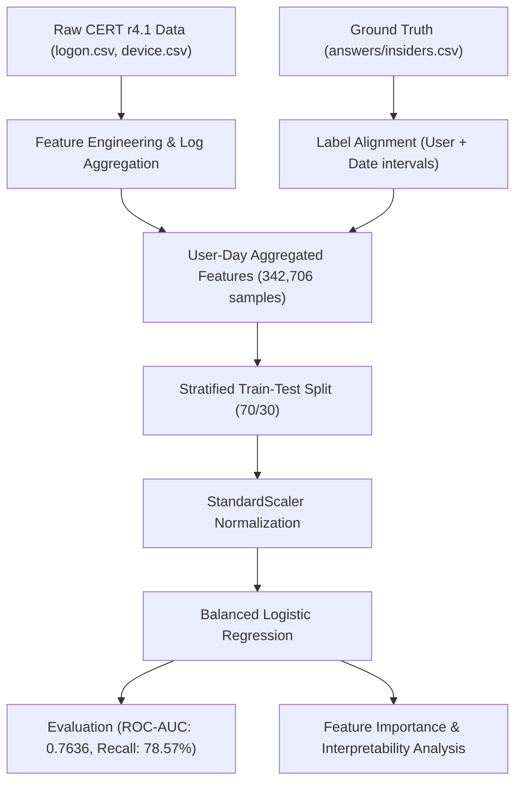

### Phase 1: Data Extraction & Environment Verification
Extraction and verification of the compressed CERT archives (`r4.1.tar.bz2` and `answers.tar.bz2`).

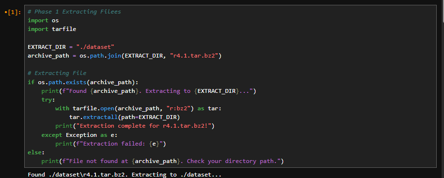

---

### Phase 2: Ground-Truth Threat Analysis
Parsing the ground-truth metadata in `answers/insiders.csv` to identify documented threat incidents for release 4.1.

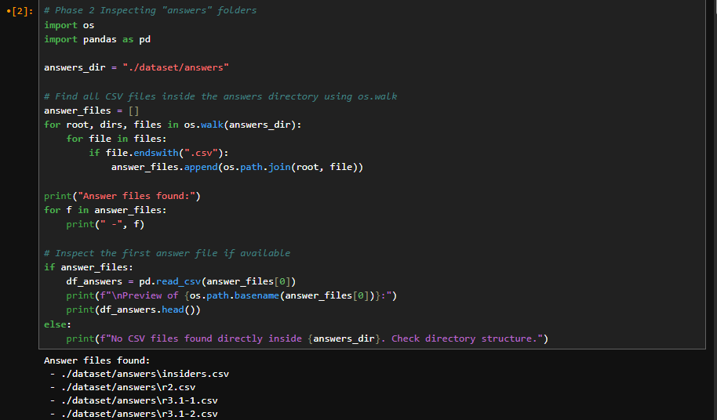
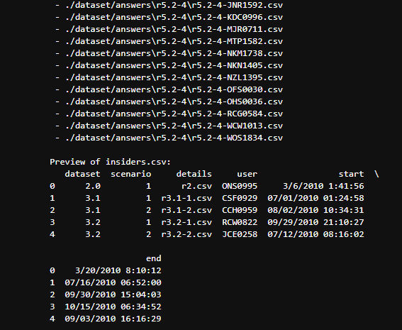
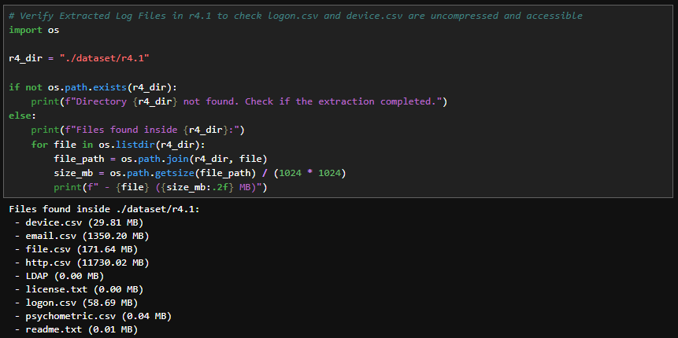
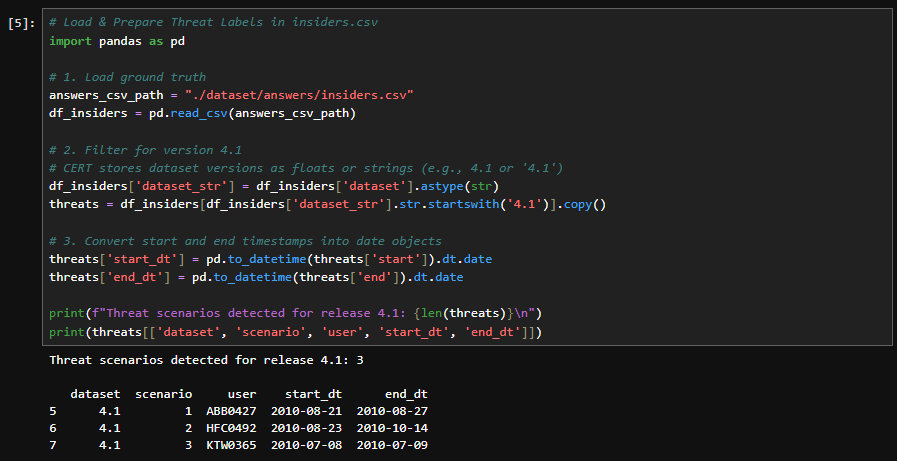

---

### Phase 3: Behavioral Feature Engineering & Aggregation
Processing raw event streams into daily aggregated behavioral profiles per user `(user, day)`:
* **Logon Features**: Total logons, total logoffs, distinct PCs accessed, after-hours logons (< 7:00 AM or > 7:00 PM), weekend logons.
* **Device Features**: USB connects, USB disconnects, after-hours USB connections.

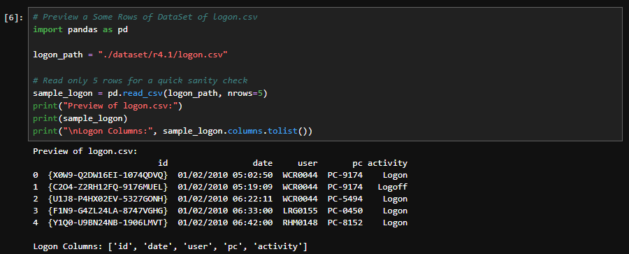
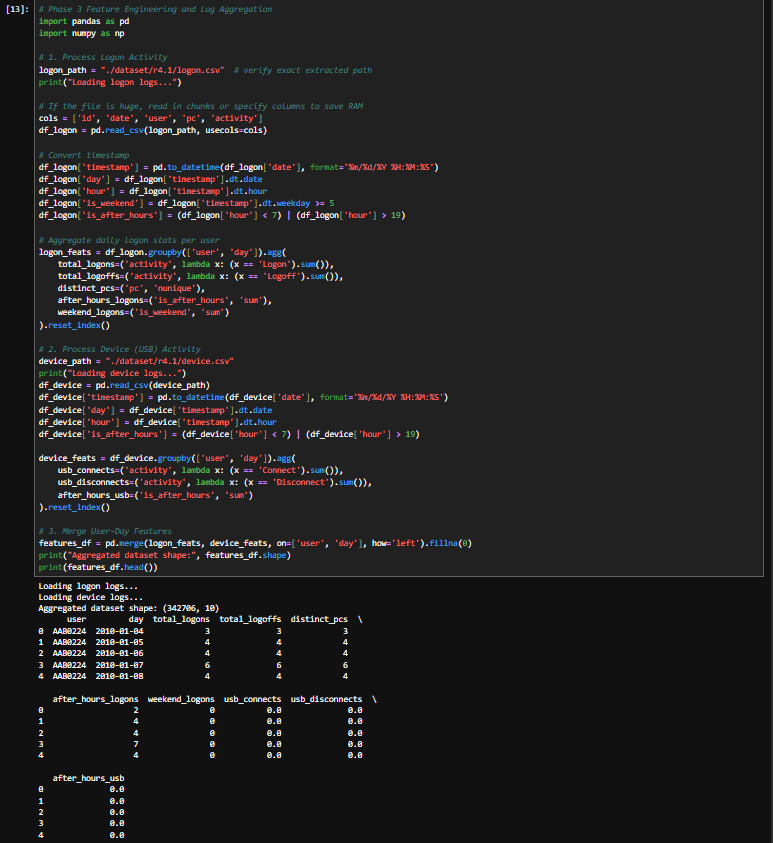

---

### Phase 4: Ground-Truth Alignment & Imbalance Analysis
Daily user records are matched against known threat intervals to create binary target labels (`0 = Normal`, `1 = Malicious`).

* **Total Records**: 342,706 user-days
* **Benign Records**: 342,659 (99.9863%)
* **Threat Records**: 47 (0.0137%)

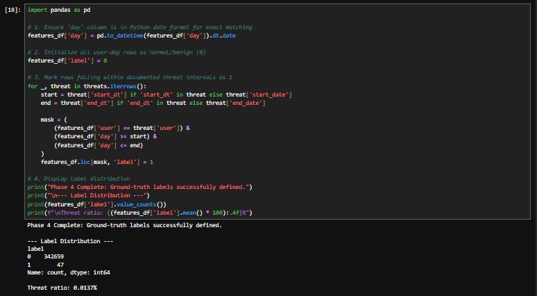

---

### Phase 5: Model Training, Evaluation & Interpretability
* **Model**: Logistic Regression with `class_weight='balanced'` to prevent bias toward the majority class.
* **Split**: 70% Train, 30% Test (Stratified).
* **Scaler**: `StandardScaler`.

#### Performance Metrics:
* **Insider Threat Recall**: **78.57%** (11 out of 14 threat days detected in the test set)
* **ROC-AUC Score**: **0.7636**
* **Normal Class Specificity**: **86.66%**

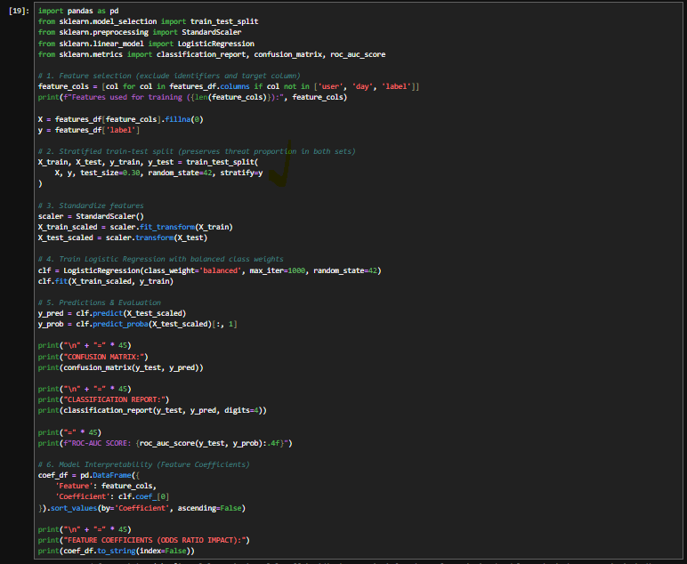

#### Interpretability & Feature Importance:
Features ranked by odds ratio impact on malicious classification:

| Feature | Coefficient | Interpretation |
| :--- | :---: | :--- |
| `usb_disconnects` | **+9.4044** | High volume of USB device removals strongly correlates with data exfiltration. |
| `total_logoffs` | **+2.3749** | Repeated logoff cycles indicate suspicious session terminations. |
| `total_logons` | **+0.6527** | High session turnover above baseline. |
| `after_hours_usb` | **+0.0483** | Removable storage activity outside business hours. |
| `weekend_logons` | **-0.0173** | General weekend activity. |
| `after_hours_logons` | **-0.9506** | After-hours logon baseline. |
| `distinct_pcs` | **-2.3483** | Typical multi-machine operational usage. |
| `usb_connects` | **-8.6781** | Baseline device connection counterweight. |

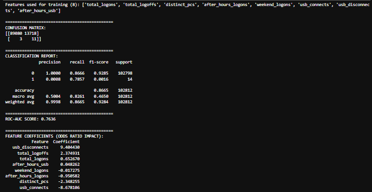

---

## 🛠️ Repository Structure

```text
├── Insider_Threat_Detection_Case_Study.ipynb   # Main Jupyter Notebook
├── ScreenShot/                                 # Step-by-step execution screenshots
│   ├── 01.png
│   ├── 02_1.png
│   ├── 02_2.png
│   ├── 03.png
│   ├── 04.png
│   ├── 05.png
│   ├── 06.png
│   ├── 07.png
│   ├── 08.png
│   └── 09.png
├── requirements.txt                           # Python dependencies
├── .gitignore                                 # Git ignore configuration
└── README.md                                  # Project documentation
```

---

## 🚀 Getting Started

### 1. Prerequisites
* Python 3.9+
* Jupyter Notebook or JupyterLab

### 2. Installation
Clone the repository and install dependencies:
```bash
git clone https://github.com/<your-username>/<your-repo-name>.git
cd <your-repo-name>
pip install -r requirements.txt
```

### 3. Dataset Setup
1. Download the CERT Insider Threat Test Dataset (Release 4.1 and Answers) from [CMU SEI](https://kilthub.cmu.edu/articles/dataset/Insider_Threat_Test_Dataset/12841247).
2. Place `r4.1.tar.bz2` and `answers.tar.bz2` (or extract them) into a `dataset/` directory in the project root:
   ```text
   dataset/
   ├── r4.1/
   │   ├── logon.csv
   │   └── device.csv
   └── answers/
       └── insiders.csv
   ```
3. Launch Jupyter:
   ```bash
   jupyter notebook Insider_Threat_Detection_Case_Study.ipynb
   ```

---

## 📜 License
This project is licensed under the MIT License - see the [LICENSE](LICENSE) file for details.
